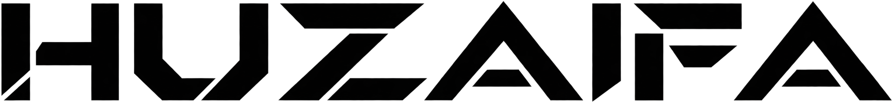

<div align="center">
  
  <h1>Muhammad Huzaifa Ali</h1>
  <p><strong>Business Development · B2B Lead Generation · Client Outreach</strong></p>
  <p>Lahore, Pakistan</p>
</div>

<p align="center">
  
  
  
  
  
</p>

<p align="center">
  
  
  
  
</p>

## About

This repository contains the portfolio website for Muhammad Huzaifa Ali, a business development and lead generation specialist. It presents his B2B prospect research, outreach, freelance client work, video editing background, and computer science studies.

## Portfolio sections

- **About** — background, current studies, and confirmed freelance metrics.
- **Services** — prospect research, lead generation, outbound campaigns, and sales pipeline support.
- **Work** — experience timeline and client-focused work.
- **Workflow** — an animated signal map explaining the research-to-outreach process.
- **Toolkit** — platforms used for prospect research, outreach, and client work.
- **Education** — BS Computer Science at Green International University.
- **Contact** — direct contact links and inquiry form.

## Built with

- Next.js and React
- TypeScript
- CSS Modules
- GSAP and Anime.js for scroll and interface motion

## Run locally

```bash
npm install
npm run dev
```

Open [http://localhost:3000](http://localhost:3000) in a browser. Use `npm run build` to create a production build.

## Repository structure

```text
src/
├── app/                         # Next.js app entry and metadata
├── components/ui/               # Reusable interface and motion components
├── features/portfolio/components/ # Portfolio page and section styles
├── hooks/                       # Shared portfolio motion hooks
└── styles/                      # Global styles and theme tokens
public/images/                   # Portraits, marks, and section artwork
```

## Topics

`business-development` · `lead-generation` · `b2b` · `client-outreach` · `nextjs` · `react` · `typescript` · `gsap` · `animejs` · `portfolio`
